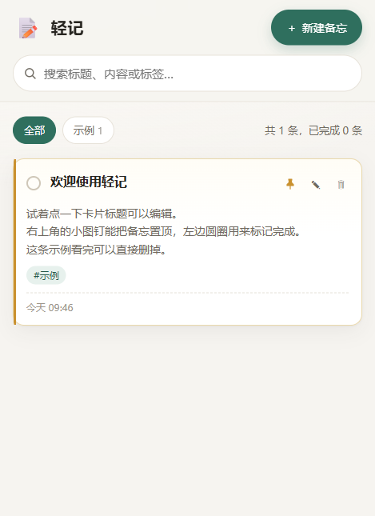

# 轻记 · 网页备忘录

一个用原生 HTML / CSS / JavaScript 写的轻量备忘录，不需要安装任何依赖，双击 `index.html` 就能用。数据保存在浏览器本地，刷新、关闭页面都不会丢。



## 功能

- **新增 / 编辑 / 删除** 备忘：点「新建备忘」或卡片标题即可编辑
- **搜索**：按标题、内容、标签实时筛选
- **标签分类**：给备忘打标签，点顶部标签一键筛选
- **置顶**：重要的备忘固定在最前面
- **完成标记**：点左侧圆圈打勾，已完成的自动沉底
- **本地持久化**：使用 `localStorage` 保存，无需服务器和数据库
- **响应式布局**：电脑、平板、手机上都能正常使用

## 运行方式

**方式一：直接打开**

双击 `index.html`，用 Chrome / Edge 打开即可。

**方式二：本地起一个静态服务（可选）**

```bash
# 如果装了 Python
python -m http.server 8080
# 然后访问 http://localhost:8080
```

**方式三：部署到 GitHub Pages 在线访问**

1. 把代码推到 GitHub 仓库
2. 打开仓库的 **Settings → Pages**
3. Source 选择 `Deploy from a branch`，分支选 `main`，目录选 `/ (root)`
4. 等一两分钟，访问 `https://<你的用户名>.github.io/<仓库名>/`

## 目录结构

```
.
├── index.html        # 页面结构
├── css/
│   └── style.css     # 样式（含响应式）
├── js/
│   └── app.js        # 全部业务逻辑
├── docs/
│   └── preview.png   # 界面预览图
└── README.md
```

## 实现说明

| 部分 | 做法 |
| --- | --- |
| 数据存储 | `localStorage`，键名 `memo.notes.v1`，值为备忘对象数组 |
| 数据结构 | `{ id, title, content, tags[], pinned, done, createdAt, updatedAt }` |
| 渲染 | 用 `<template>` 克隆卡片，事件委托统一处理点击 |
| 排序 | 置顶优先 → 未完成优先 → 更新时间倒序 |
| 编辑弹窗 | 原生 `<dialog>` 元素，支持 Esc 关闭和点击遮罩关闭 |
| 输入校验 | 标题不能为空；标签按逗号/空格拆分、去重，最多 5 个 |

## 快捷键

- `Ctrl + Enter`（Mac 为 `⌘ + Enter`）：在编辑弹窗里保存
- `Esc`：关闭编辑弹窗

## 数据说明

所有数据只存在你自己的浏览器里，不会上传到任何服务器。清除浏览器数据或换一台设备，内容会丢失。
